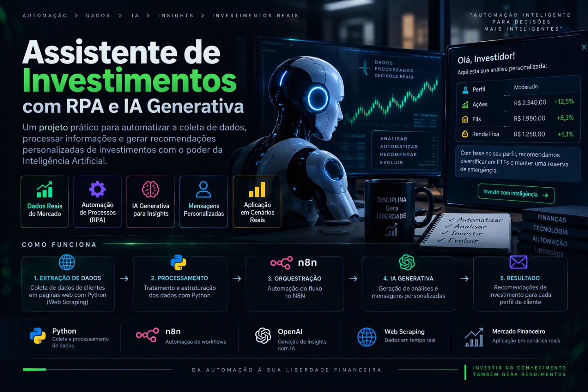

<p align="center">
  
</p>

<h1 align="center">Assistente de Investimentos com RPA e IA Generativa</h1>

<p align="center">
  <a href="https://www.python.org/">
    
  </a>
  <a href="https://n8n.io/">
    
  </a>
  <a href="https://platform.openai.com/docs/">
    
  </a>
  <a href="https://ai.google.dev/">
    
  </a>
  <a href="https://jupyter.org/">
    
  </a>
  <a href="https://opensource.org/licenses/MIT">
    
  </a>
  <a href="https://codeql.github.com/">
    
  </a>
  
  
</p>

## Sobre o Projeto

Este projeto educacional demonstra como combinar **RPA em Python**, **orquestração de workflows no n8n** e **IA generativa** em um cenário de atendimento relacionado ao mercado financeiro.

O notebook extrai dados de uma página de demonstração, organiza informações de clientes — como nome, saldo e perfil de investidor — e prevê o envio desses dados a um webhook do n8n. O workflow processa cada cliente e usa um agente de IA para gerar uma mensagem informativa e personalizada de acordo com o perfil e o saldo.

O projeto não executa transações nem acessa contas financeiras. As mensagens geradas são demonstrativas e não constituem recomendação de investimento.

> **Estado atual da integração:** o notebook ainda contém um TODO para enviar os dados ao webhook, e o workflow exportado está inativo. Para executar o pipeline de ponta a ponta, configure o webhook e as credenciais no n8n e ative o workflow.

## Fluxo de Funcionamento (Pipeline de Dados)

1. **Extração de dados — Web Scraping/RPA**  
   O notebook usa `requests` e `BeautifulSoup` para buscar e interpretar a tabela de clientes da [página de demonstração da DIO](https://digitalinnovationone.github.io/dio-lab-assistente-investimentos-rpa-n8n/).

2. **Processamento e tratamento**  
   Cada linha da tabela é convertida em um dicionário Python com os campos `nome`, `email`, `saldo` e `perfil`. O notebook atual não usa Pandas; a transformação é feita com estruturas nativas do Python.

3. **Orquestração no n8n**  
   O arquivo `n8n/workflow.json` define um webhook POST chamado `clientes`, seguido pelo nó **Split Out**, que separa os dados em itens individuais. O notebook ainda precisa ser conectado ao webhook para enviar a lista de clientes.

4. **IA Generativa**  
   O agente de IA recebe o perfil e o saldo do cliente. O workflow atual está configurado para usar **Google Gemini 1.5 Flash** e inclui opções ilustrativas de investimento no prompt. **OpenAI GPT-4 não está conectado no workflow atual**; pode ser considerado como alternativa mediante configuração de um nó e de credenciais apropriadas.

5. **Resultado Final**  
   Quando o workflow estiver ativo e configurado, o nó **Responder Webhook** devolve o texto gerado pelo agente. A resposta pode então ser apresentada ou utilizada pelo sistema que chamou o webhook.

## Tecno-Stack e Ferramentas

- **Python 3.10+:** linguagem recomendada para executar o notebook.
- **Requests e BeautifulSoup:** dependências usadas atualmente para buscar e interpretar o HTML.
- **Pandas:** não é usado no notebook atual; pode ser adicionado se o processamento tabular evoluir.
- **Jupyter Notebook:** ambiente para executar `rpa/extrair_clientes.ipynb`.
- **n8n:** workflow exportado em `n8n/workflow.json`; requer importação, configuração das credenciais e ativação.
- **Google Gemini 1.5 Flash:** modelo configurado no workflow atual.
- **OpenAI GPT-4:** alternativa possível, ainda não configurada neste repositório.
- **Qualidade e Governança 4.0:** referências a ISO 9001 e Lean Six Sigma Green Belt relacionadas a práticas de qualidade e melhoria contínua; os selos não representam certificação deste projeto.
- **CodeQL:** selo informativo sobre a ferramenta. Não há workflow CodeQL configurado no repositório.
- **Licença MIT:** selo incluído conforme solicitado. O repositório ainda não contém um arquivo `LICENSE`; adicione-o na raiz para formalizar a licença.

## Como Executar o Projeto Localmente

Requer Python 3.10 ou superior. O repositório ainda não possui `requirements.txt`, então as dependências são instaladas diretamente com `pip`.

1. Clone o repositório e entre na pasta do projeto:

   ```bash
   git clone https://github.com/Rafael-TOZATO/dio-lab-assistente-investimentos-rpa-n8n.git
   cd dio-lab-assistente-investimentos-rpa-n8n
   ```

2. Crie e ative um ambiente virtual:

   ```bash
   python -m venv .venv
   ```

   macOS/Linux:

   ```bash
   source .venv/bin/activate
   ```

   Windows PowerShell:

   ```powershell
   .venv\Scripts\Activate.ps1
   ```

3. Instale as dependências usadas pelo notebook:

   ```bash
   python -m pip install --upgrade pip
   python -m pip install requests beautifulsoup4 notebook
   ```

   Pandas e `python-dotenv` são opcionais para o código atual. Instale-os apenas se forem necessários para extensões futuras:

   ```bash
   python -m pip install pandas python-dotenv
   ```

4. Inicie o Jupyter Notebook e abra o notebook de extração:

   ```bash
   jupyter notebook rpa/extrair_clientes.ipynb
   ```

5. Para executar o pipeline completo, importe `n8n/workflow.json` no n8n, configure a credencial do Google Gemini, ative o workflow e conecte o notebook ao webhook `clientes`.

### Variáveis de Ambiente e Credenciais

O notebook atual não carrega um arquivo `.env` nem envia o POST ao n8n. Se adicionar código Python para ler essas variáveis, instale `python-dotenv` e crie um `.env` local, sem incluir valores reais no repositório:

```env
N8N_WEBHOOK_URL=
GEMINI_API_KEY=
OPENAI_API_KEY=

```
O workflow do n8n deve receber a credencial do Google Gemini pelo gerenciador de credenciais do próprio n8n. Nunca versione arquivos `.env` nem chaves de API.

## 📬 Contatos

- 💼 **LinkedIn:** [rafaeltozato81](https://www.linkedin.com/in/rafaeltozato81)
- 🐙 **GitHub:** [Rafael-TOZATO](https://github.com/Rafael-TOZATO)
- ✍️ **Medium:** [@ornelas.tozato](https://medium.com/@ornelas.tozato)
- 🌐 **Portfólio PWA (Dev Hub):** [tozato-dev-hub.vercel.app](https://tozato-dev-hub.vercel.app)
- 🌐 **H-Folio:** [h-folio-psi.vercel.app](https://h-folio-psi.vercel.app)
- 🚀 **Aurora BI (Lovable):** [aurora-bi-dio.lovable.app](https://aurora-bi-dio.lovable.app)
- 📜 **Microsoft Learn:** [Transcript](https://learn.microsoft.com/pt-br/users/rafaelornelastozato-2209/transcript/dzo2wizrzkx2853)
